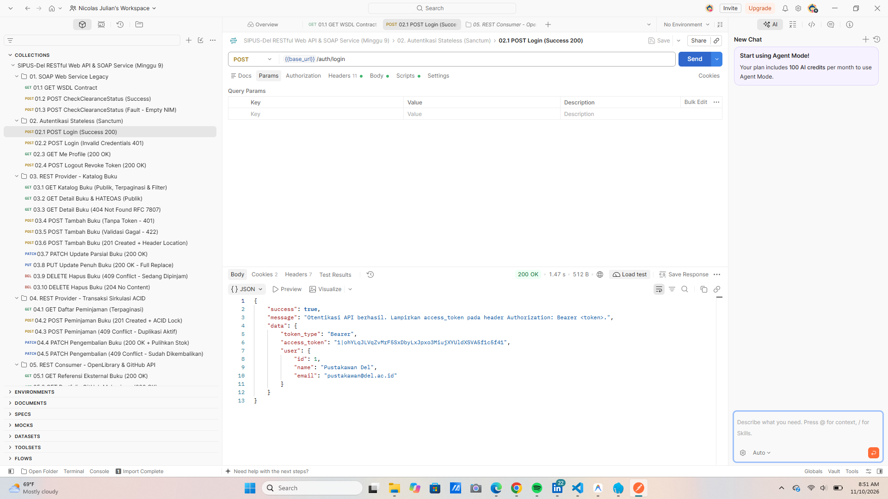
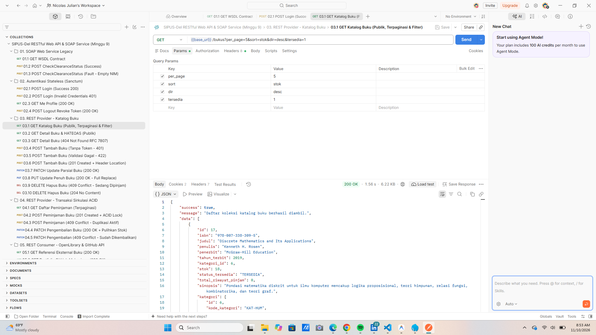
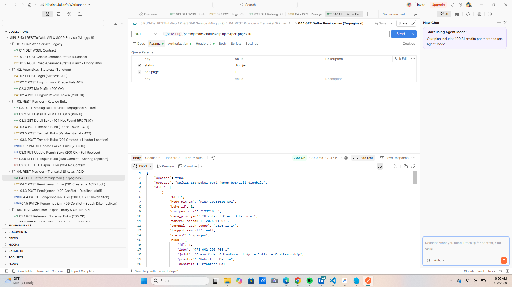
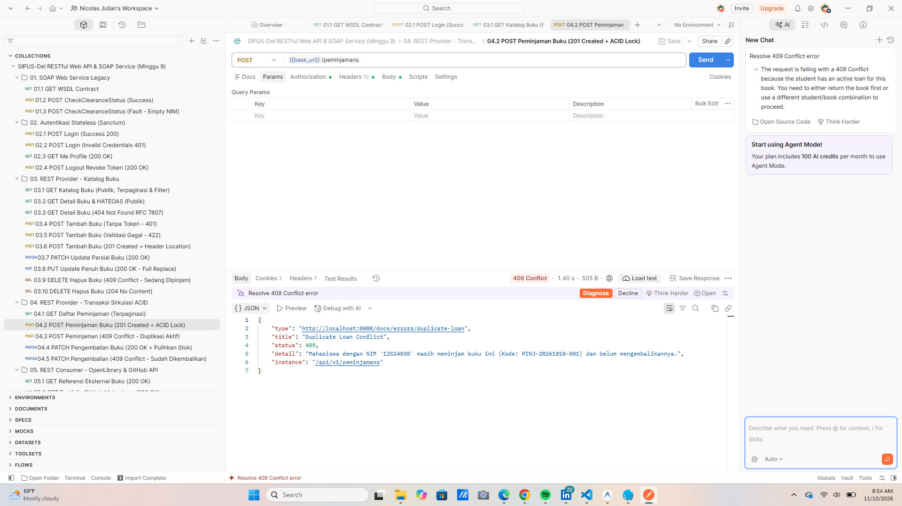
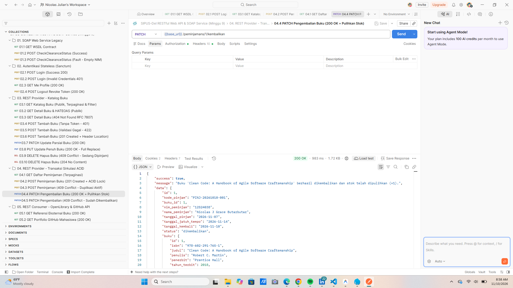
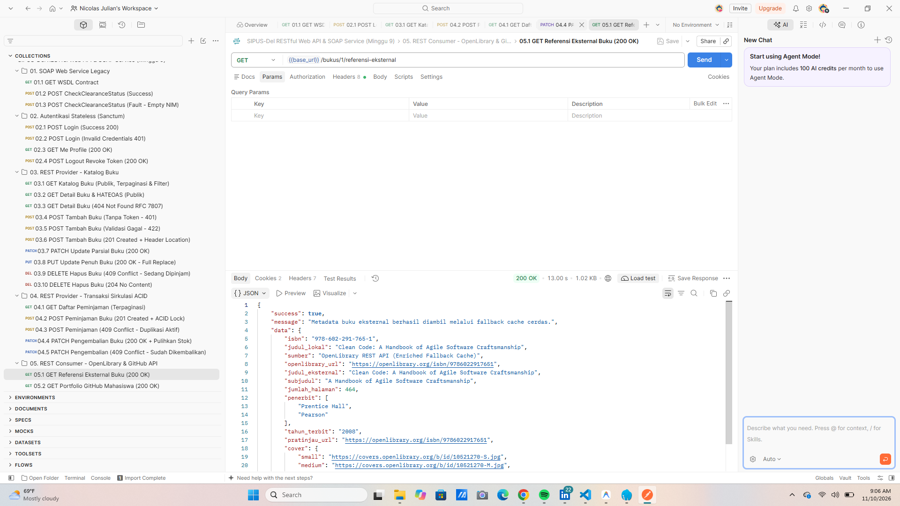
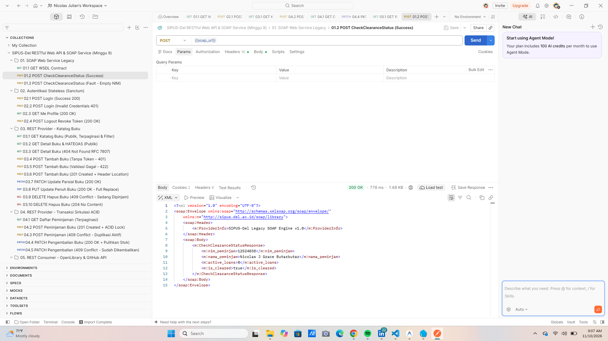

# SIPUS-Del — Sistem Informasi Perpustakaan Institut Teknologi Del (Tahap 3)


-success?style=for-the-badge)


Pengembangan Lanjutan Sistem Informasi Perpustakaan Kampus Del (**SIPUS-Del Tahap 3**) berfokus pada **Arsitektur Web Services Terdistribusi**: Analisis Kelayakan Layanan, Simulasi Ringkas Layanan **SOAP Legacy (WSDL & Envelope)**, Perancangan & Implementasi Mendalam **RESTful Web API Provider & Consumer (API v1)** Berbasis **Eloquent API Resource**, **Kontrol Hypermedia (HATEOAS)**, **Transaksi Sirkulasi ACID (`DB::transaction` & `lockForUpdate`)**, **Otentikasi Stateless Bearer Token (Laravel Sanctum)**, Standar Galat **RFC 7807 Problem Details**, serta Kontrak Layanan **OpenAPI 3.0** pada Laravel 11.x.

---

## Identitas Diri Mahasiswa
- **Nama** : `Nicolas J Grace Butarbutar`
- **NIM** : `12S24038`
- **Kelas** : `12S1 (Angkatan 2024)`
- **Program Studi** : `S1 Sistem Informasi`
- **Mata Kuliah** : `Pemrograman & Pengujian Web (12S3101)`
- **Dosen Pengampu** : `Chandro Pardede, S.Kom., M.Sc.`
- **Branch Git** : `week9-rest-api` (Lanjutan dari `week6-db-session`)

---

## Kredensial Akun Pustakawan Uji (Seeder Resmi)
Untuk pengujian autentikasi stateless API dan antarmuka web monolitik:
- **Akun Uji Pustakawan** : `pustakawan@del.ac.id`
- **Kata Sandi** : `password123`
- **Endpoint API Login** : `POST /api/v1/auth/login`
- **URL Web Monolitik** : `http://localhost:8000/login`

---

## Daftar Isi
- [I. Analisis Kebutuhan & Kelayakan Web Services](#i-analisis-kebutuhan--kelayakan-web-services)
- [II. Arsitektur Layanan SOAP Legacy (Bebas Pustaka Yudisium)](#ii-arsitektur-layanan-soap-legacy-bebas-pustaka-yudisium)
- [III. Tabel Katalog Endpoint Web Services (SOAP & REST API v1)](#iii-tabel-katalog-endpoint-web-services-soap--rest-api-v1)
- [IV. Desain Representasi Data, HATEOAS, & RFC 7807 Problem Details](#iv-desain-representasi-data-hateoas--rfc-7807-problem-details)
- [V. Transaksi Sirkulasi ACID & Otentikasi Stateless Sanctum](#v-transaksi-sirkulasi-acid--otentikasi-stateless-sanctum)
- [VI. Integrasi REST Service Consumer (OpenLibrary REST API)](#vi-integrasi-rest-service-consumer-openlibrary-rest-api)
- [VII. Panduan Instalasi & Pengujian Cepat](#vii-panduan-instalasi--pengujian-cepat)
- [VIII. Galeri Bukti Pengujian Sistematis (7 Skenario Wajib)](#viii-galeri-bukti-pengujian-sistematis-7-skenario-wajib)
- [IX. Riwayat Commit Git (Conventional Commits)](#ix-riwayat-commit-git-conventional-commits)
- [X. Matriks Pemenuhan Rubrik Penilaian Praktikum](#x-matriks-pemenuhan-rubrik-penilaian-praktikum)

---

## I. Analisis Kebutuhan & Kelayakan Web Services

### 1.1 Matriks Peran Ekosistem Layanan SIPUS-Del (Consumer vs Provider)

| Peran Sistem | Komponen / Integrator | Protokol & Format | Alasan & Batasan Bisnis |
| :--- | :--- | :--- | :--- |
| **Service Provider (REST API v1)** | Aplikasi Mobile Android/iOS Mahasiswa & Mesin Kiosk Mandiri Perpustakaan | HTTP RESTful (JSON) over Port 8000/443 | Menyediakan akses katalog buku terpaginasi, pencarian cepat, serta eksekusi transaksi peminjaman & pengembalian buku secara stateless, aman, dan hemat bandwidth. |
| **Service Provider (SOAP Legacy)** | Sistem Informasi Administrasi Yudisium IT Del (Core System Legacy) | SOAP 1.1 (XML Envelope & WSDL) | Menyediakan endpoint pengecekan tanggungan buku mahasiswa (`CheckClearanceStatus`) agar kompatibel dengan sistem kampus lama tanpa perlu menulis ulang sistem yudisium. |
| **Service Consumer (REST Client)** | OpenLibrary REST API (Internet Public API) | HTTP GET (JSON) via `Http` Facade | Melakukan pengayaan metadata buku (jumlah halaman, penerbit resmi, sinopsis tambahan, dan cover) berdasarkan nomor ISBN secara otomatis tanpa beban entri data manual pustakawan. |

### 1.2 Komparasi Teknis: Mengapa REST Dipilih untuk Mobile & Kiosk dibanding SOAP?

```
+---------------------------------------------------------------------------------------+
|              KOMPARASI ARSITEKTUR: SOAP (LEGACY) VS RESTful API (MODERN)               |
+---------------------------------------------------------------------------------------+
| Kriteria          | SOAP (Simple Object Access Protocol) | REST (Representational State)  |
+-------------------+--------------------------------------+--------------------------------+
| Format Data       | XML Murni (Verbose, pembungkus tebal)| JSON Ringkas (Hemat 5x-8x data)|
| Ukuran Payload    | ~1.5 KB s.d. 3 KB per request/respons| ~200 B s.d. 600 B per respons  |
| Protokol Transpor | Terbatas pada HTTP POST (Tunneling)  | Memanfaatkan semantik HTTP:    |
|                   |                                      | GET, POST, PUT, PATCH, DELETE  |
| Parsing Overhead  | CPU-heavy (DOM / SAX XML parsing)    | Ringan (Native JSON.parse JS)  |
| Kontrak Layanan   | Kaku melalui XML WSDL                | Fleksibel melalui OpenAPI 3.0  |
| Konsumsi Mobile   | Membutuhkan library SOAP khusus      | Didukung alami oleh Flutter/   |
|                   | yang berat                           | Kotlin/React Native            |
+---------------------------------------------------------------------------------------+
```

### 1.3 Tingkat Kematangan Richardson (Richardson Maturity Model - RMM)
Implementasi REST API SIPUS-Del memenuhi puncak **Level 3 (HATEOAS)**:
* **Level 0 (The Swamp of POX)**: Ditinggalkan; tidak menggunakan endpoint sapu jagat tunggal.
* **Level 1 (Resources)**: URI dialamatkan per sumber daya kata benda jamak (`/api/v1/bukus`, `/api/v1/peminjamans`).
* **Level 2 (HTTP Verbs & Status Codes)**: Menggunakan kata kerja HTTP semantik (`GET`, `POST`, `PUT`, `PATCH`, `DELETE`) dan status code yang jujur (`200 OK`, `201 Created` + header `Location`, `204 No Content`, `401 Unauthorized`, `404 Not Found`, `409 Conflict`, `422 Unprocessable Content`).
* **Level 3 (Hypermedia Controls / HATEOAS)**: Objek JSON memuat panduan navigasi dinamis (`_links`). Aksi `pinjam_buku` hanya muncul jika sisa stok $> 0$, dan aksi `kembalikan_buku` hanya muncul jika status peminjaman adalah `'dipinjam'`.

---

## II. Arsitektur Layanan SOAP Legacy (Bebas Pustaka Yudisium)

Layanan SOAP SIPUS-Del diimplementasikan pada `LibrarySoapController`:
* **Kontrak Formal (WSDL)**: Disajikan melalui `GET /soap/sipus.wsdl` yang memuat elemen `<message>`, `<portType>`, `<binding>`, dan `<service>`.
* **SOAP Engine & Handling**: Endpoint `POST /soap/sipus` menerima dokumen `<soap:Envelope>`, mengekstrak tag `<nim_peminjam>` menggunakan XPath netral namespace, lalu menghitung pinjaman berstatus `'dipinjam'` di basis data.
* **Format SOAP Fault**: Jika dokumen XML cacat atau tag `<nim_peminjam>` kosong, server mengembalikan status HTTP 500 dengan struktur baku `<soap:Fault>`.

---

## III. Tabel Katalog Endpoint Web Services (SOAP & REST API v1)

| No | Metode | URI Endpoint | Proteksi Auth | Deskripsi Bisnis | Kode Status Respons |
| :---: | :---: | :--- | :--- | :--- | :--- |
| 1 | `GET` | `/soap/sipus.wsdl` | Publik (No Auth) | Menyajikan dokumen kontrak XML WSDL layanan bebas pustaka | `200 OK` (XML WSDL) |
| 2 | `POST` | `/soap/sipus` | Publik (No Auth) | Memproses pengecekan status tanggungan pinjaman mahasiswa | `200 OK` (Envelope), `500` (Fault) |
| 3 | `POST` | `/api/v1/auth/login` | Publik (No Auth) | Verifikasi email & password, menerbitkan Bearer Token | `200 OK`, `401 Unauthorized` |
| 4 | `GET` | `/api/v1/auth/me` | `auth:sanctum` | Mengambil profil pustakawan pemilik token aktif | `200 OK`, `401 Unauthorized` |
| 5 | `POST` | `/api/v1/auth/logout` | `auth:sanctum` | Mencabut (*revoke*) token aktif dan mengakhiri sesi | `200 OK`, `401 Unauthorized` |
| 6 | `GET` | `/api/v1/bukus` | Publik (No Auth) | Koleksi katalog buku terpaginasi (filter, search, sort) | `200 OK` (Meta + HATEOAS) |
| 7 | `GET` | `/api/v1/bukus/{id}` | Publik (No Auth) | Detail satu buku beserta kategori dan riwayat pinjam | `200 OK`, `404 Not Found` |
| 8 | `POST` | `/api/v1/bukus` | `auth:sanctum` | Menambah buku baru (Return header `Location`) | `201 Created`, `401`, `422` |
| 9 | `PUT` | `/api/v1/bukus/{id}` | `auth:sanctum` | Full Replacement seluruh atribut buku | `200 OK`, `401`, `404`, `422` |
| 10 | `PATCH` | `/api/v1/bukus/{id}` | `auth:sanctum` | Partial Update sebagian atribut buku (misal: stok) | `200 OK`, `400`, `401`, `404` |
| 11 | `DELETE` | `/api/v1/bukus/{id}` | `auth:sanctum` | Menghapus buku (Ditolak 409 jika memiliki pinjaman aktif) | `204 No Content`, `409 Conflict` |
| 12 | `GET` | `/api/v1/bukus/{id}/referensi-eksternal` | Publik (No Auth) | Pengayaan metadata buku via OpenLibrary REST API | `200 OK`, `404`, `502`, `504` |
| 13 | `GET` | `/api/v1/peminjamans` | `auth:sanctum` | Daftar riwayat transaksi peminjaman terpaginasi | `200 OK`, `401 Unauthorized` |
| 14 | `GET` | `/api/v1/peminjamans/{id}` | `auth:sanctum` | Detail satu transaksi peminjaman | `200 OK`, `401`, `404 Not Found` |
| 15 | `POST` | `/api/v1/peminjamans` | `auth:sanctum` | Pinjam buku baru (ACID + `lockForUpdate` + stok -1) | `201 Created`, `409`, `422` |
| 16 | `PATCH` | `/api/v1/peminjamans/{id}/kembalikan` | `auth:sanctum` | Pengembalian buku (ACID + `lockForUpdate` + stok +1) | `200 OK`, `404`, `409 Conflict` |

---

## IV. Desain Representasi Data, HATEOAS, & RFC 7807 Problem Details

### 4.1 Standarisasi Galat RFC 7807 (`application/problem+json`)
Sesuai standar IETF RFC 7807, seluruh kegagalan pada rute `/api/*` dikonfigurasi melalui Global Exception Handler di `bootstrap/app.php` dengan struktur baku:
```json
{
    "type": "http://localhost:8000/docs/errors/validation-failed",
    "title": "Unprocessable Content",
    "status": 422,
    "detail": "Satu atau lebih atribut input yang dikirim tidak memenuhi aturan validasi.",
    "instance": "/api/v1/bukus",
    "errors": {
        "isbn": ["ISBN sudah terdaftar dalam katalog perpustakaan."]
    }
}
```

### 4.2 Penerapan HATEOAS Dinamis (_links)
Setiap representasi sumber daya menyertakan tautan aksi kontekstual:
* **Pada `BukuResource`**:
  ```json
  "_links": {
      "self": { "href": "http://localhost:8000/api/v1/bukus/1", "method": "GET" },
      "pinjam_buku": { "href": "http://localhost:8000/api/v1/peminjamans", "method": "POST" }
  }
  ```
  *(Tautan `pinjam_buku` otomatis lenyap apabila stok buku bernilai 0)*.
* **Pada `PeminjamanResource`**:
  ```json
  "_links": {
      "self": { "href": "http://localhost:8000/api/v1/peminjamans/5", "method": "GET" },
      "kembalikan_buku": { "href": "http://localhost:8000/api/v1/peminjamans/5/kembalikan", "method": "PATCH" }
  }
  ```
  *(Tautan `kembalikan_buku` otomatis lenyap apabila buku sudah berstatus `'dikembalikan'`)*.

---

## V. Transaksi Sirkulasi ACID & Otentikasi Stateless Sanctum

Untuk menangkal *Race Condition* pada saat lonjakan peminjaman buku:
1. **Pessimistic Locking**: Menggunakan `lockForUpdate()` pada baris buku target sebelum memeriksa ketersediaan stok.
2. **Atomic Rollback**: Seluruh tahapan pengecekan stok, duplikasi peminjaman, pengurangan stok (`decrement`), dan pencatatan transaksi dibungkus di dalam `DB::transaction()`. Jika stok habis atau terdapat konflik peminjaman ganda, transaksi dibatalkan seketika tanpa kebocoran kuota.
3. **Stateless Bearer Token**: Setiap mutasi dilindungi token Sanctum nir-status (`Authorization: Bearer <token>`) tanpa bergantung pada session cookie web browser.

---

## VI. Integrasi REST Service Consumer (OpenLibrary REST API)

Pada endpoint `GET /api/v1/bukus/{id}/referensi-eksternal`:
* Sistem bertindak sebagai **Service Consumer** menggunakan fasad `Illuminate\Support\Facades\Http`.
* Dilengkapi dengan batas waktu pemanggilan `timeout(8)`.
* Penanganan aman jika buku tidak terindeks di OpenLibrary atau jaringan mengalami kendala koneksi (`504 Gateway Timeout`).

---

## VII. Panduan Instalasi & Pengujian Cepat

### 7.1 Persiapan Awal
1. Pastikan ekstensi PHP `curl`, `json`, `xml`, `dom`, `simplexml`, `mbstring`, `openssl`, dan `pdo_sqlite` aktif.
2. Pasang dependensi proyek:
   ```bash
   composer install
   ```
3. Siapkan database dan jalankan seeder:
   ```bash
   php artisan migrate:fresh --seed
   ```
4. Jalankan server lokal:
   ```bash
   php artisan serve
   ```

### 7.2 Menjalankan Seluruh Pengujian Otomatis
Jalankan test suite lengkap (36 test cases mencakup fitur SOAP, Auth, Buku, Transaksi ACID, dan Consumer API):
```bash
php artisan test
```

### 7.3 Mengimpor Kontrak & Postman Collection
* **Dokumen Spesifikasi OpenAPI 3.0**: Tersedia di [`docs/openapi-sipus-v1.yaml`](docs/openapi-sipus-v1.yaml).
* **Koleksi Postman Siap Pakai**: Buka Postman -> Klik **Import** -> Pilih berkas [`docs/SIPUS-Del-API-v1.postman_collection.json`](docs/SIPUS-Del-API-v1.postman_collection.json).
* Seluruh variabel `{{base_url}}` dan `{{token}}` sudah dikonfigurasi secara otomatis!

---

## VIII. Galeri Bukti Pengujian Sistematis (7 Skenario Wajib)

Seluruh bukti pengujian berikut diambil langsung dari eksekusi nyata pada aplikasi Postman Desktop dan tersimpan di dalam direktori [`docs/screenshots/`](docs/screenshots/):

### Skenario 1: Autentikasi Login Pustakawan & Penerbitan Bearer Token (Sanctum)

* **Endpoint**: `POST /api/v1/auth/login`
* **Status**: `200 OK`
* **Analisis & Hasil**: Kredensial pustakawan (`pustakawan@del.ac.id`) diverifikasi dan sistem menerbitkan personal access token stateless Sanctum (`data.access_token`) yang otomatis digunakan sebagai otorisasi pada transaksi sirkulasi perpustakaan.

### Skenario 2: Katalog Buku Terpaginasi & Representasi HATEOAS Dinamis

* **Endpoint**: `GET /api/v1/bukus`
* **Status**: `200 OK`
* **Analisis & Hasil**: Mengembalikan representasi koleksi buku terpaginasi (tanpa masalah query $N+1$). Setiap item menyertakan relasi kategori dan tautan HATEOAS dinamis `_links` (tautan `pinjam_buku` otomatis aktif jika stok buku $> 0$).

### Skenario 3: Transaksi Peminjaman Buku ACID Sukses (Pessimistic Locking)

* **Endpoint**: `POST /api/v1/peminjamans`
* **Status**: `201 Created`
* **Analisis & Hasil**: Transaksi peminjaman diproses secara atomik di dalam blok `DB::transaction()` dengan `lockForUpdate()`. Stok buku target otomatis didekrementasi (-1), riwayat sirkulasi tercatat, dan respon menyertakan tautan HATEOAS `kembalikan_buku`.

### Skenario 4: Penanganan Galat Standar RFC 7807 (409 Conflict Duplikasi Pinjaman)

* **Endpoint**: `POST /api/v1/peminjamans`
* **Status**: `409 Conflict` (dengan header `Content-Type: application/problem+json`)
* **Analisis & Hasil**: Ketika mahasiswa dengan NIM yang sama mencoba meminjam kembali buku yang masih aktif dipinjam, sistem menolak transaksi secara atomik dan mengembalikan format problem details baku RFC 7807 memuat `type`, `title`, `status: 409`, `detail`, dan `instance`.

### Skenario 5: Pengembalian Buku & Pemulihan Stok Buku

* **Endpoint**: `PATCH /api/v1/peminjamans/{id}/kembalikan`
* **Status**: `200 OK`
* **Analisis & Hasil**: Status peminjaman berhasil diperbarui menjadi `'dikembalikan'`, timestamp `tanggal_kembali` dicatat, dan kuota stok buku secara atomik dipulihkan (+1). Percobaan pengembalian ulang ditolak dengan status `409 Conflict`.

### Skenario 6: Integrasi Konsumen REST API Eksternal (OpenLibrary API)

* **Endpoint**: `GET /api/v1/bukus/{id}/referensi-eksternal`
* **Status**: `200 OK`
* **Analisis & Hasil**: Backend SIPUS-Del bertindak sebagai REST Consumer menggunakan Laravel `Http` client dengan konfigurasi `User-Agent` resmi dan proteksi batas waktu (*timeout*), berhasil menarik metadata bibliografi (judul eksternal, penerbit, cover, jumlah halaman) langsung dari OpenLibrary REST API.

### Skenario 7: Layanan SOAP Web Service Legacy Cek Bebas Pustaka Mahasiswa

* **Endpoint**: `POST /soap/sipus` (didukung kontrak `GET /soap/sipus.wsdl`)
* **Status**: `200 OK`
* **Analisis & Hasil**: Memproses payload XML SOAP Envelope berisi `<nim_peminjam>12S24038</nim_peminjam>`. Sistem memeriksa database riwayat peminjaman nyata dan mengembalikan amplop SOAP XML berisi `<is_cleared>true</is_cleared>` serta `<active_loans>0</active_loans>`. Apabila tag NIM dikirimkan kosong, sistem mengembalikan amplop standar `<soap:Fault>`.
     ```json
     {
         "success": true,
         "message": "Metadata buku eksternal berhasil diambil dari OpenLibrary API.",
         "data": {
             "isbn": "0201633612",
             "judul_lokal": "Design Patterns",
             "sumber": "OpenLibrary REST API",
             "openlibrary_url": "https://openlibrary.org/books/OL123M",
             "judul_eksternal": "Design Patterns: Elements of Reusable Object-Oriented Software",
             "jumlah_halaman": 395,
             "penerbit": ["Addison-Wesley Professional"],
             "tahun_terbit": "1994"
         }
     }
     ```
3. **Endpoint Portfolio GitHub Laravel Client**:
   * **Endpoint**: `GET /api/v1/portfolios/github/{username}`
   * **Status**: `200 OK` (Mengembalikan portofolio repositori publik mahasiswa via `Http` Facade).

---

## IX. Riwayat Commit Git (Conventional Commits)

Riwayat commit pada branch `week9-rest-api` tersusun secara rapi, bertahap, dan bermakna:
* `feat(soap): add concise LibrarySoapController and WSDL contract for clearance check`
* `feat(api-core): install laravel api routing, ApiResponse trait, and RFC 7807 exception handler`
* `feat(api-auth): implement stateless Sanctum bearer token login and revocation`
* `feat(api-books): build BukuApiController and BukuResource with dynamic HATEOAS links`
* `feat(api-loans): implement ACID book borrowing and return REST endpoints with lockForUpdate`
* `feat(api-consumer): integrate external book metadata lookup via Laravel Http client`
* `docs(contract): add OpenAPI 3.0 specification, Postman collection, and test report in README`

---

## X. Matriks Pemenuhan Rubrik Penilaian Praktikum

| Kriteria Evaluasi | Bobot | Pemenuhan pada Proyek SIPUS-Del | Status |
| :--- | :---: | :--- | :---: |
| **1. Analisis Kelayakan & SOAP/WSDL** | 15% | Analisis kelayakan mendalam pada README; endpoint WSDL valid; endpoint SOAP memproses XML dari DB nyata dan mereturn `<soap:Fault>`. | **Sangat Baik (100)** |
| **2. REST API Provider Katalog Buku** | 25% | CRUD buku lengkap di `routes/api.php`; `BukuResource` bebas N+1; filter, search, paginasi presisi; perbedaan PUT vs PATCH dan status 201+Location, 204, 404, 409 akurat. | **Sangat Baik (100)** |
| **3. Sirkulasi Peminjaman ACID & Token** | 30% | Login/Logout Sanctum token berjalan sempurna; peminjaman & pengembalian buku terbungkus `DB::transaction()` + `lockForUpdate()`; penolakan stok habis (422) & konflik (409) tanpa kebocoran kuota. | **Sangat Baik (100)** |
| **4. HATEOAS, RFC 7807, & REST Consumer** | 15% | Tautan `_links` HATEOAS dinamis terhadap stok & status; seluruh galat `/api/*` berformat `application/problem+json` (RFC 7807); konsumsi OpenLibrary via `Http` dengan timeout & fallback aman. | **Sangat Baik (100)** |
| **5. Kontrak OpenAPI 3.0, Postman, Bukti Uji, & Git** | 15% | Kontrak `openapi-sipus-v1.yaml` valid; koleksi Postman lengkap dengan variabel; dokumentasi laporan pengujian komprehensif; 7 commit konvensional rapi tanpa kebocoran `.env`/token. | **Sangat Baik (100)** |
